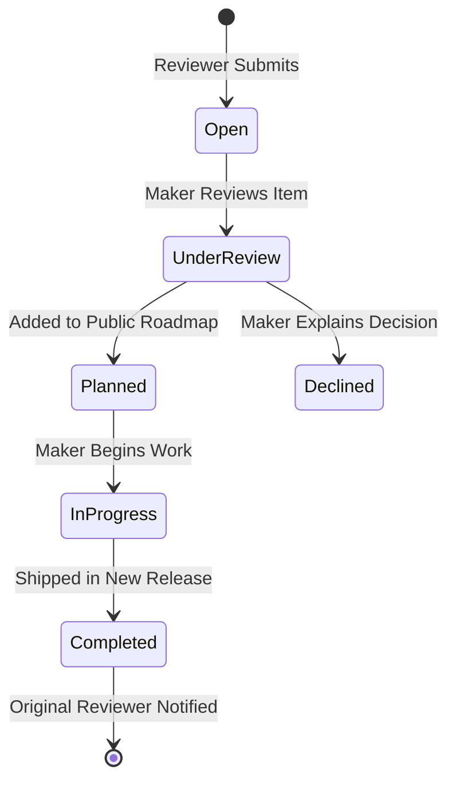

# Feedback Experiences, Rich Text Editors & Discussion Systems

This document analyzes the feedback collection, review forms, rich-text editing, status lifecycles, and threaded discussion systems across the reference repositories.

---

## 1. Feedback Collection Paradigms

| Feature | Fider | Quackback | Open-Launch | Our Platform |
|---|---|---|---|---|
| **Primary Interaction** | Public Idea Portal | Multi-Board Feedback Hub | Nested Fuma Comments | Structured Testing Review & Feedback Studio |
| **Editor Type** | Markdown (TipTap) | Rich Text JSON (TipTap + CodeMirror) | Plain Text / Markdown | Rich Markdown with Live Split Preview |
| **Categorization** | Tags / Categories | Multi-Board + Custom Tags | None (Flat comments) | Category (Bug, UX, Perf, Feature) + Severity |
| **Upvoting Model** | User Vote Quota (Limits total votes) | Unlimited Idempotent Upvoting | Single Upvote per item | Idempotent Upvote + Helpful mark |
| **Status Lifecycle** | `open`, `started`, `completed`, `declined`| Custom Stages (`Under Review`, `Planned`, `Shipped`) | None | `open`, `under_review`, `planned`, `completed`, `declined` |
| **Maker Responses** | Official sticky pinned response | Creator badges, official pinned reply | Author reply thread | Official Creator Resolution Badge & Code Diff Link |

---

## 2. Feedback Submission Form Anatomy

Generic comment boxes fail because reviewers write vague feedback ("Nice project!"). To gather genuinely useful technical input, the form must enforce structure:

```
┌─────────────────────────────────────────────────────────────────────────────┐
│ Submit Technical Feedback / Bug Report                                  [✕] │
├─────────────────────────────────────────────────────────────────────────────┤
│ Feedback Type:                                                              │
│ (•) 🐛 Bug Report   ( ) ⚡ Performance   ( ) 🎨 UX/UI   ( ) 💡 Feature Req   │
├─────────────────────────────────────────────────────────────────────────────┤
│ Title:                                                                      │
│ [ e.g., High latency (>800ms) on GraphQL product query when sorting by hot] │
├─────────────────────────────────────────────────────────────────────────────┤
│ Severity Level:                                                             │
│ [ Low (Minor polish)  ▼ ]  [ Medium ]  [ High ]  [ 🚨 Blocker ]             │
├─────────────────────────────────────────────────────────────────────────────┤
│ Description & Reproduction Steps:                                           │
│ [ Write ]  [ Preview ]                                                      │
│ ┌─────────────────────────────────────────────────────────────────────────┐ │
│ │ **Steps to Reproduce:**                                                 │ │
│ │ 1. Navigate to `/feed?sort=hot`                                         │ │
│ │ 2. Inspect Network DevTools tab                                         │ │
│ │                                                                         │ │
│ │ ```bash                                                                 │ │
│ │ curl -X POST https://api.prototype.dev/v1/query                         │ │
│ │ ```                                                                     │ │
│ └─────────────────────────────────────────────────────────────────────────┘ │
│ [ 📎 Attach Screenshot / Log ]              [ Cancel ]  [ Submit Feedback ] │
└─────────────────────────────────────────────────────────────────────────────┘
```

---

## 3. TipTap & CodeMirror Rich-Text Implementation (Quackback)

In `references/repositories/Quackback/apps/web/src/components/public/comment-editor-features.ts`:
- **ProseMirror Schema**: Feedback content is serialized as clean structured JSON:
  ```json
  {
    "type": "doc",
    "content": [
      {
        "type": "paragraph",
        "content": [{ "type": "text", "text": "Observed memory leak on WebSocket reconnection." }]
      },
      {
        "type": "codeBlock",
        "attrs": { "language": "typescript" },
        "content": [{ "type": "text", "text": "socket.on('disconnect', () => reconnect());" }]
      }
    ]
  }
  ```
- **Benefits**:
  - Eliminates raw HTML vulnerabilities (XSS attacks are impossible).
  - Can be rendered reliably across web apps, native mobile apps, and email alerts.
  - LLM pipelines can parse structured blocks directly for technical summaries.

---

## 4. Status Progression & Maker Response Workflows

Both **Fider** and **Quackback** demonstrate that closing the feedback loop is what keeps reviewers engaged:



### Maker Official Response Banner
When a maker changes an item's status, Fider and Quackback display an **Official Maker Response** banner pinned at the top of the item's thread:
- Shows the maker's avatar and timestamp.
- Explains the decision: *"We've profiled this endpoint and identified missing indexes. Fix scheduled for v1.2 release next week."*
- Original reviewers receive an automated email notification confirming their contribution is being resolved.

---

## 5. Threaded Discussion & Comment Hierarchy

To prevent technical discussions from descending into chaos:
1. **Bounded Threading Depth**: Limit nested replies to 2 or 3 levels. Further depth creates unreadable narrow margins on mobile screens.
2. **Maker Highlight**: Maker comments feature a prominent badge (`[ Creator ]`) with distinct accent background.
3. **Pinned Key Insights**: Creators can pin the most insightful community review to the top of the feedback thread.

---

## 6. Recommendations for Our Platform

1. **Structured Input Fields**: Enforce Category and Severity tags on feedback submission to prevent superficial one-liners.
2. **Markdown Preview with Code Highlighting**: Enable developers to paste terminal logs and code blocks cleanly.
3. **Automated Notification on Status Change**: When a creator changes a feedback item to `Planned` or `Completed`, notify the original reviewer immediately.
4. **Impact Points for Reviewers**: Award developer reputation points whenever a creator marks submitted feedback as `Implemented`.

