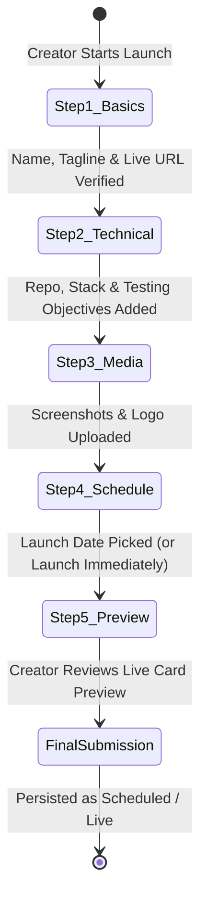

# Product Launch Workflows, Submission Wizards & Previews

This document reverse-engineers the product launch workflows, multi-step wizards, URL validation mechanisms, live preview cards, and launch scheduling systems across the reference repositories.

---

## 1. Multi-Step Launch Wizard Architecture

A successful developer launch workflow balances exhaustive data collection with a low-friction submission experience. Below is the multi-step state machine reverse-engineered from **Open-Launch** and **Peerlist**:



---

## 2. In-Depth Step Analysis & Form Engineering

### Step 1: Core Identity & URL Validation
- **URL Verification**: In Open-Launch (`api/projects/check-url/route.ts`), the backend performs a real-time HTTP HEAD request against the submitted URL:
  - Verifies the URL resolves with an HTTP 200/301 status.
  - Automatically fetches OpenGraph metadata (`og:title`, `og:description`, `og:image`), pre-populating form inputs to save creator time.
  - Rejects broken, offline, or localhost links.
- **Anti-Spam Verification**: Integrates Cloudflare Turnstile (`@marsidev/react-turnstile`) silently in the background.

### Step 2: Technical Specifications & Testing Prompts
- **Tech Stack Selector**: Multi-select pill selector (e.g., `React`, `Python`, `FastAPI`, `PostgreSQL`, `Tailwind`, `Docker`).
- **Open-Source Flag**: Checkbox indicating whether the project is open-source, with GitHub repository URL validation.
- **Creator Testing Objectives**: A dedicated section prompting:
  *"What specific areas do you need community developers to test?"*
  - Example: *“Load testing our WebSocket reconnection logic”* or *“Reviewing mobile navigation on iOS Safari”*.

### Step 3: Media & Visual Assets
- **Logo Squircle**: 1:1 aspect ratio upload (PNG/SVG/WebP) with client-side image compression.
- **Screenshots Gallery**: Drag-and-drop zone supporting up to 5 screenshots, with reordering via drag handles.
- **Video Walkthrough**: Optional Loom or YouTube embed URL for creators demonstrating their prototype workflow.

### Step 4: Launch Scheduling & Timezone Synchronization
- **Daily Launch Window**: Launches are synchronized to **00:00:01 UTC** daily:
  - Creators choose their launch date up to 30 days in advance.
  - A countdown timer shows: *"Launches in 3 days, 14 hours"*.
  - Makers receive automated calendar invites and email preparation reminders (`api/cron/send-ongoing-reminders`).

### Step 5: High-Fidelity Live Preview Card
Before final submission, the wizard displays a **live preview** showing exactly how the prototype card will appear in the public discovery feed:
- Live rank simulator (`#1 Preview`).
- Formatted logo, title, and truncated tagline.
- Interactive upvote button (disabled in preview mode).
- Gives creators immediate visual confidence before going public.

---

## 3. Draft Persistence & Recovery

- **The Problem**: Filling out a technical submission requires effort; losing progress due to an accidental tab closure causes extreme creator frustration.
- **The Pattern**:
  - The wizard form state is continuously synchronized to browser `localStorage` on every keystroke (`launch_draft_v1`).
  - Upon reopening the wizard, the client prompts: *"We found an unsaved draft from 2 hours ago. [Resume Draft] [Discard]"*.

---

## 4. Launch Day Checklist for Creators

Before launching to the community, creators should complete an automated pre-flight checklist:

```
[✓] Live Prototype URL responds with HTTP 200 (SSL certificate valid)
[✓] At least 3 high-resolution screenshots attached
[✓] GitHub repository is public and accessible
[✓] At least one specific testing prompt configured for reviewers
[✓] Maker intro comment drafted to greet early reviewers
```

---

## 5. Recommendations for Our Platform

1. **Implement Automated OpenGraph Metadata Scraping**: Pre-fill title, description, and preview image as soon as the creator enters their demo URL.
2. **Mandate "Testing Session Objectives"**: Require every launched prototype to state what technical feedback is requested.
3. **Persist Form State in LocalStorage**: Protect creators from losing complex submission drafts.
4. **Display Live Feed Preview**: Show creators an exact pixel-accurate simulation of their feed card before scheduling.

