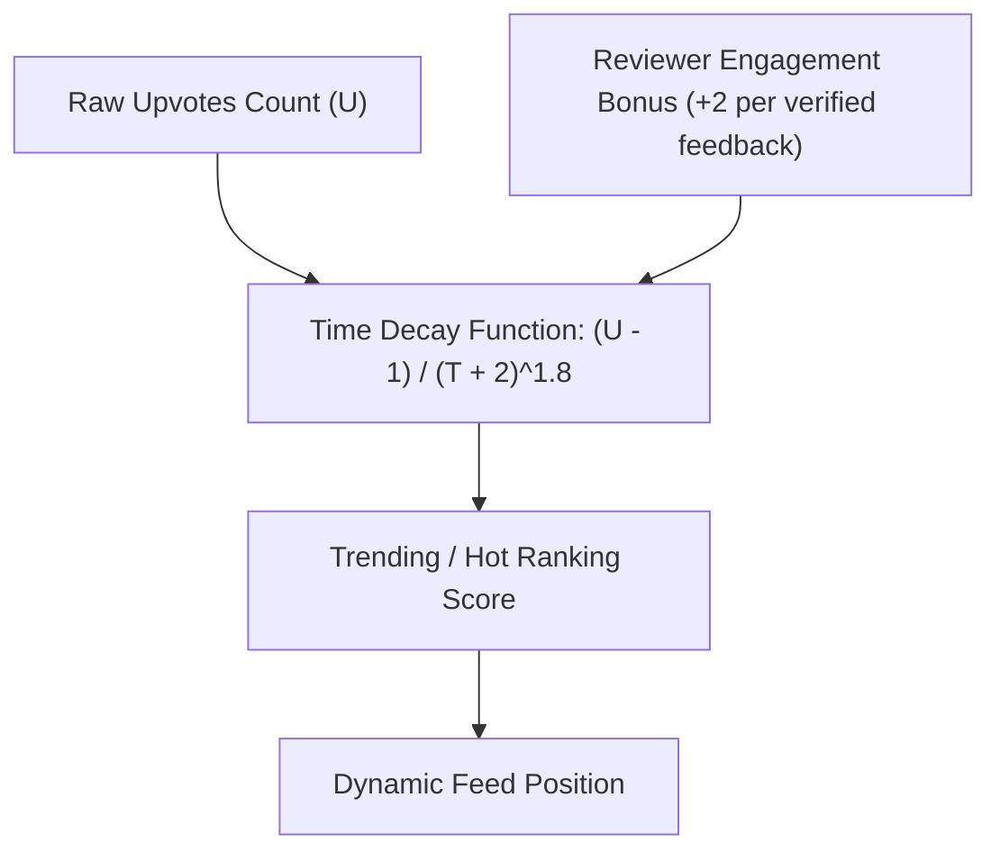

# Product Discovery, Feed Sorting & Listing Cards

This document analyzes the product discovery experiences, feed sorting mechanics, filtering systems, and listing card components across the reference repositories.

---

## 1. Product Feed Organization & Temporal Grouping

### A. Daily Launch Cadence (Open-Launch & Product Hunt)
Open-Launch structures its homepage around a daily drop timeline:
- **Grouping**:
  - `🚀 Today's Launches` (Live voting open until 23:59:59 UTC)
  - `📅 Yesterday's Launches` (Rankings finalized; badges awarded)
  - `⏳ Previous Days` (Collapsible archive blocks by date)
- **Psychological Effect**: Creates daily anticipation and viral launch events. Makers mobilize their developer networks to upvote within a clear 24-hour window.

### B. Continuous Developer Feed (Peerlist-Clone)
- Unlike daily batches, Peerlist-Clone uses an infinite scrolling activity stream where new posts, project updates, and spotlight launches mix chronologically with community discussions.
- **Suitability**: Better for ongoing social engagement, but weaker for concentrated launch events.

---

## 2. Ranking & Sorting Algorithms



### A. Hacker News / Product Hunt Gravity Formula
Both Open-Launch and Product Hunt balance popularity with recency using a gravity decay formula:
$$\text{Score} = \frac{U - 1}{(T + 2)^G}$$
- $U$: Number of unique user upvotes.
- $T$: Elapsed hours since launch.
- $G$: Gravity factor (typically 1.5 to 1.8).
- **Benefit**: Prevents an early popular product from monopolizing the #1 spot permanently; newer high-momentum prototypes rapidly rise to the top.

### B. Multi-Dimensional Sorting Tabs
Quackback and Fider offer transparent sorting tabs:
1. **Trending / Hot**: Score with gravity decay.
2. **Top / Most Upvoted**: Pure aggregate upvote counter.
3. **Newest**: Reverse chronological by creation timestamp.
4. **Needs Feedback**: Prototypes with fewer than 3 reviews (surfacing undiscovered indie projects).

---

## 3. Product Listing Card Anatomy

The listing card is the single most critical conversion element on the discovery surface. Below is the optimized structure reverse-engineered from Open-Launch and Product Hunt:

```
┌─────────────────────────────────────────────────────────────────────────────┐
│ [ #1 ]  [ LOGO ]  ReflectAI                                  ▲ 184 Upvoted  │
│                   Next-generation AI feedback synthesis for devs            │
│                   [ Web App ]  [ AI / LLM ]  [ Open Source ]  💬 32 Reviews  │
└─────────────────────────────────────────────────────────────────────────────┘
```

### Key Elements of the Card:
1. **Rank Badge**: Visual indicator (`#1`, `#2`, `#3`) with bronze/silver/gold highlights for top performers.
2. **Product Logo / Favicon**: Crisp 48x48px rounded squircle logo with subtle shadow.
3. **Product Title & Tagline**: Title in bold sans-serif; tagline truncated to 1–2 concise lines describing the technical value proposition.
4. **Metadata Pills**:
   - Platform type (`Web`, `Mobile`, `CLI`, `API`).
   - Stage badge (`Prototype`, `Beta`, `Production`).
   - Review counter (`💬 24 reviews`) signaling active community testing.
5. **Upvote Button**:
   - Placed at the right edge for thumb and mouse accessibility.
   - Includes the chevron icon (`▲`), current count, and active toggle state.
   - Distinct hover state with energetic scale animation.

---

## 4. Category & Faceted Filtering UX

- **Filter Pills**: Horizontal scrolling pill bar on mobile; sticky sidebar or clean top row on desktop:
  `[ All ]` `[ DevTools ]` `[ AI / LLMs ]` `[ Web3 ]` `[ Open Source ]` `[ Mobile ]` `[ Productivity ]`
- **Active State**: Inverted background color (white text on dark background) with instantaneous client-side filtering.
- **Search UX**:
  - Search input with clear button (`✕`) and debounced typing (250ms).
  - Matches against product name, tagline, and category keywords.

---

## 5. Empty States & Error Resilience

When filters yield zero results:
- **Visual**: Subtle illustrative icon (e.g., search radar or empty box).
- **Copy**: "No prototypes match your active filters."
- **Recovery Action**:
  - Secondary button: `Clear all filters`.
  - Primary button: `Launch a prototype in this category`.
- Never leave the user at a dead end.

---

## 6. Recommendations for Our Platform

1. **Implement Dual Feed Views**: Provide both a "Today's Launches" daily drop view and a "Trending Prototypes" exploratory grid.
2. **Highlight Prototype Testing Status**: Add a distinct "Needs Testers" badge to prototypes with active testing sessions.
3. **Incorporate Feedback Count on Cards**: Show reviewers where their technical feedback is most urgently needed.
4. **Ensure Sub-50ms Client Filtering**: Filter products instantly using pre-cached in-memory collections.

