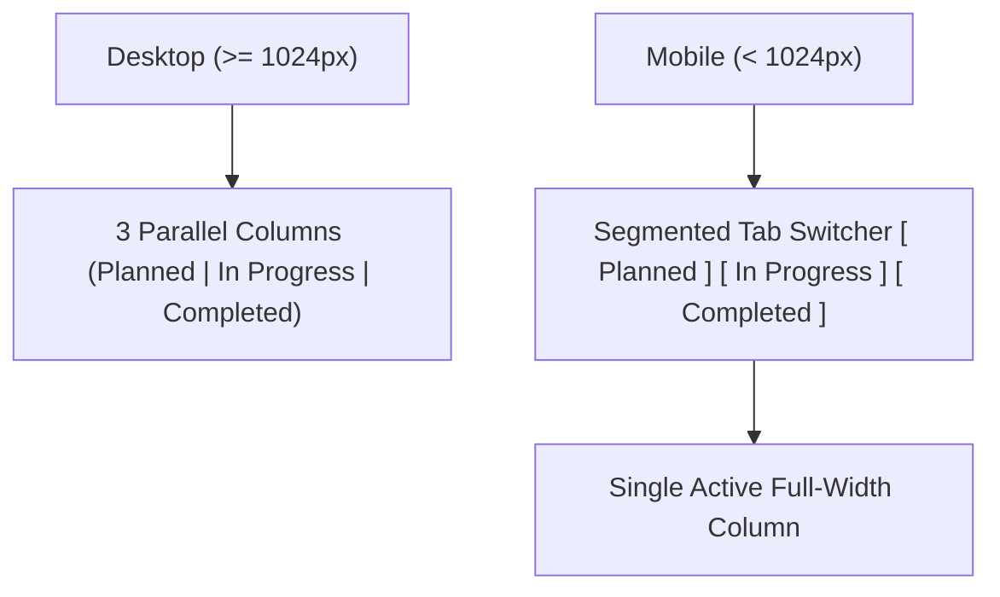

# Responsive Design Patterns, Mobile Viewports & Touch Engineering

This document analyzes responsive layouts, adaptive grids, mobile navigation, touch ergonomics, and drawer sheets across the reference repositories.

---

## 1. Breakpoint Architecture & Viewport Strategy

Our platform targets three distinct developer usage scenarios:

| Viewport Profile | Width Range | Target Devices | Primary User Objective | Layout Archetype |
|---|---|---|---|---|
| **Mobile Compact** | 360px – 640px | iPhone, Pixel, Galaxy | Quick feed browsing, upvoting, reading notifications | Single-column feed, bottom nav bar, bottom sheet drawers |
| **Tablet / Foldable**| 641px – 1024px | iPad, Surface, foldables | Detailed review reading, testing prototypes, commenting | 2-column adaptive layout, collapsible sidebar |
| **Desktop / Wide** | 1025px – 1920px+ | MacBook, 4K monitors | Launching prototypes, deep code review, roadmap Kanban | 3-column dense workspace, split-pane feedback studio |

---

## 2. Mobile Bottom Navigation & Thumb Ergonomics

On mobile devices (< 640px), reaching the top header requires awkward hand repositioning.
- **The Pattern**:
  - The sticky desktop header simplifies to a minimal top branding bar.
  - A fixed glassmorphic **Bottom Navigation Bar** appears at the base of the screen:
    ```
    ┌────────────────────────────────────────────────────────┐
    │   [ 🚀 Discover ]  [ 🔍 Search ]  [ 🔔 Alerts ]  [ 👤 Profile ]   │
    └────────────────────────────────────────────────────────┘
    ```
- **Touch Target Requirements**:
  - Every icon and button adheres to WCAG 2.1 AA standards with a minimum touch bounding box of **44x44 pixels**.
  - Visual padding (`py-2 px-3`) ensures comfortable tapping without accidental adjacent triggers.

---

## 3. Responsive Kanban Roadmaps & Data Tables

A common responsive failure in developer tools is horizontal scrolling overflow on Kanban boards and dense data tables.



### A. Responsive Kanban Adaptation (Quackback)
- **Desktop**: Renders 3 side-by-side columns with drag-and-drop handles.
- **Mobile**: Automatically transforms into a **segmented tab control**:
  `[ Planned (8) ]` `[ In Progress (4) ]` `[ Completed (19) ]`
  Selecting a tab displays that column full-width, eliminating chaotic horizontal scrolling and cramped columns.

### B. Responsive Bento Grids (Open-Launch)
- Utilizes CSS Grid with responsive column spans:
  ```css
  grid grid-cols-1 md:grid-cols-2 lg:grid-cols-3 gap-4
  ```
- Product cards expand gracefully to 100% width on mobile, stack in 2 columns on tablets, and form a balanced 3-column grid on desktop displays.

---

## 4. Drawers & Bottom Sheets (`Vaul` / Radix Dialog)

When users view feedback details or submit quick notes on mobile:
- **Desktop**: Centered modal dialog or split-pane right sidebar.
- **Mobile**: Anchored **Bottom Sheet Drawer** (using Radix or Vaul drawer mechanics):
  - Slides smoothly from the bottom of the screen with rubber-band physics.
  - Features an intuitive grab handle indicator (`w-12 h-1.5 bg-muted rounded-full mx-auto my-2`).
  - Swiping down dismisses the sheet cleanly.

---

## 5. Horizontal Category Scrolling without Ugly Scrollbars

For category filter tags on mobile:
```css
.no-scrollbar::-webkit-scrollbar {
  display: none;
}
.no-scrollbar {
  -ms-overflow-style: none;
  scrollbar-width: none;
}
```
- Class: `flex items-center gap-2 overflow-x-auto no-scrollbar touch-pan-x px-4`
- Developers can flick categories smoothly with their thumb without visual scrollbar clutter disrupting the aesthetic.

---

## 6. Recommendations for Our Platform

1. **Implement Bottom Navigation for Mobile**: Ensure core discovery and notification destinations are thumb-accessible.
2. **Transform Mobile Roadmaps to Segmented Views**: Collapse multi-column Kanban boards into tabbed views on screens narrower than 1024px.
3. **Use Bottom Sheets for Mobile Feedback**: Open review dialogs as bottom sheets on mobile devices for seamless one-handed input.
4. **Maintain 44px Minimum Touch Targets**: Ensure all voting buttons, filters, and interactive chips pass strict touch accessibility tests.

